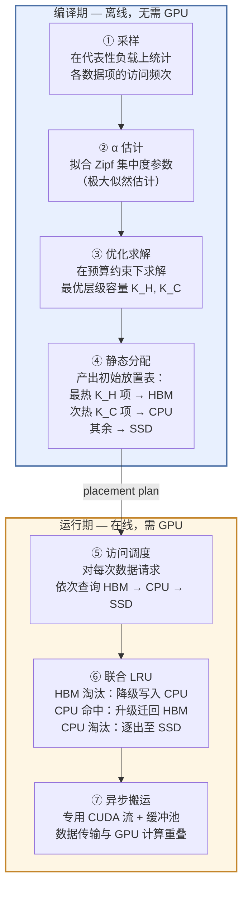

# MECC：一种面向 Sub-CPU 内存预算的无损三级缓存架构及其在混合专家推理中的应用
## 中期工作报告

---

## 摘要

本文提出 MECC（MoE Expert Cache Compiler），一种无损三级缓存架构，系统性地利用现代硬件存储层级——HBM、CPU 锁页内存与 SSD——之间的性能差异，为总数据量超过可用 CPU 内存容量的场景提供高效的缓存服务。该架构耦合两种互补机制：编译期依据参数化热度模型确定数据项在各层级的初始分布；运行期通过**联合动态 LRU**策略将 HBM 与 CPU 视为统一的淘汰栈——HBM 淘汰时数据降级写入 CPU，CPU 命中时数据升级迁回 HBM。我们给出形式化分析，在 Zipf 热度假设下，缓存命中率可表示为广义调和数之比的闭合形式，期望取数延迟关于各层容量单调递减，且数据传输全程为恒等映射——保证输出与全量驻留 HBM 时逐比特一致。

我们随后将该架构实例化到**混合专家（MoE）推理**。MoE expert 具有只读、可分块、稀疏激活和路由可观测等性质，是三级对象缓存的自然验证域。在大型模型中，expert 权重总量可达约 90 GB（fp16），并在受限部署预算下迫使 SSD 进入关键路径。在 A100 80GB、冷 SSD 平台上，MECC 相对同预算的 SwapMoE-style 静态 CPU 机制对照取得 **1.33 倍综合加速**，OURS 的 fp16 困惑度为 **24.57**，并将 SSD 命中率从 34.5% 降至 17.6%。历史结果中的 36.12 对照 PPL 身份尚未核实，因此不与速度结果合成为量化质量结论。

---

## 1. 引言

现代计算系统呈现深度异构的存储层级：从微秒级延迟但容量有限的高带宽存储器（HBM），到毫秒级延迟、容量中等的 CPU 内存，再到百毫秒级延迟但 TB 级容量的固态存储。如何有效利用这一层级结构，处理总数据量超出任意单一层级容量的工作负载，构成一项基础性挑战。

我们提出一种专为上述 sub-CPU-memory 区制设计的缓存架构，其组织围绕三项设计原则。

**原则一：编译期静态放置**，由参数化热度模型驱动。在正式服务前，通过代表性负载对数据项进行 profile，估计 Zipf 集中度参数 $\alpha$，并在该模型下求解各层级的最优容量分配，使期望取数延迟最小化。

**原则二：上两层的联合动态 LRU**。运行期将 HBM 与 CPU 锁页内存作为一个统一的 LRU 栈管理：HBM 淘汰时数据项降级写入 CPU（spill），CPU 命中时数据项升级迁回 HBM（promote），SSD 作为冷存储仅容纳最少访问的尾部数据。

**原则三：恒等数据搬运**。所有层级间的数据传输均为精确内存拷贝，不施加任何量化、剪枝或近似操作。因此，依赖缓存数据的任意计算结果，与全部数据驻留 HBM 的情形逐比特一致。

我们给出形式化分析：在 Zipf 热度分布下，命中率具有闭合形式（命题 1），期望延迟目标函数关于容量分配单调（命题 2），恒等搬运保证精度不变（命题 3）。

该架构随后在**混合专家推理场景**中实例化。以 Mixtral-8×7B 为代表的大型 MoE 模型中，expert 权重总量在受限节点上可能超过可用 CPU 内存。MECC 用三级放置容纳全部 expert，并把搬运限定为 fp16 恒等映射；联合 LRU 则在运行期访问偏离 profile 时对初始放置进行在线修正。需要强调的是，联合 LRU 对静态拆分并不存在任意 trace 的普遍支配保证，本文只把它作为在线机制，并由特定配置下的真机结果评估。

本文贡献如下：

| 编号 | 内容 | 对应章节 |
|:---:|:---|:---:|
| C1 | 形式化 sub-CPU 预算下的三级对象缓存问题，明确容量、访问与迁移成本 | §3–§5 |
| C2 | 提出编译期先验放置与运行期在线纠偏协同的三级缓存架构 | §4 |
| C3 | 证明当前等大小特例的静态按秩放置与恒等搬运语义保持性 | §5 |
| C4 | 将架构实例化于 MoE，并在 Mixtral SSD 强制场景中验证 | §6–§7 |

---

## 2. 背景与预备知识

### 2.1 三级存储层级

考虑由三个延迟递增的层级构成的存储体系 $\mathcal{T} = \{H, C, S\}$，其中 $H$ 为 GPU 高带宽存储器（HBM），$C$ 为 CPU 锁页内存，$S$ 为 NVMe 固态存储。从层级 $t$ 取回大小为 $s$ 的数据块的延迟建模为固定开销与传输时间之和：

$$
T_t(s) = \mathrm{lat}_t + \frac{s}{\mathrm{bw}_t}
$$

在 RTX 5090 平台上实测的参数下，三级延迟呈现约四个数量级的跨度：

| 层级 | 实测延迟 | 相对 HBM 倍数 |
|:---|:---|:---:|
| HBM（命中） | 255.8 µs | 1× |
| CPU 锁页（命中） | 6,504 µs | ~25× |
| SSD（冷读） | 789,739 µs | ~3,088× |

关键结构性质在于层级间的**延迟鸿沟**：$T_H \ll T_C \ll T_S$。SSD 延迟高出 HBM 约三个数量级，因此任何面向此层级的缓存设计必须以最小化 SSD 访问为核心目标。将 SSD 命中率从 $h_S$ 降至 $h_S'$，期望延迟近似线性下降，因为 $T_H$ 与 $T_C$ 贡献的仅为低阶项。

### 2.2 替换策略与 LRU

当缓存层级满容量时，替换策略决定淘汰哪个驻留项。最近最少使用（LRU）策略淘汰最久未被访问的项。LRU 在具有时间局部性的访问模式下表现良好，本文将其用于 HBM 层级的独立管理以及 HBM+CPU 的联合管理。

### 2.3 混合专家推理

一个 MoE 层包含 $N$ 个 expert 前馈网络（本工作中为 SwiGLU 结构，含 gate、up、down 三组权重矩阵）。对每个输入 token，门控网络选出 top-$k$ 个 expert（Mixtral $k=2$，DeepSeek $k=6$），该层输出为被选 expert 输出的加权和：

$$
\text{output} = \sum_{e \in \text{top-}k} g_e \cdot \mathrm{Expert}_e(x)
$$

MoE 推理部署的核心矛盾在于计算与存储的非对称性：**计算**开销与 $k$ 成正比（较小），**存储**开销与全部 $N$ 个 expert 成正比（极大）。以 Mixtral-8×7B 为例，$N=8$，单 expert 约 336 MB，$L=32$ 层，expert 权重总量约 90 GB（fp16）——远超单卡 A100 的 80 GB HBM，且在常见部署配置下也超出可用 CPU 内存。

### 2.4 既有 Expert 管理方案

现有 MoE expert 权重管理方案可沿两个维度分类：使用的存储层级数量，以及是否保持精度。

| 方法 | 层级 | 精度保持 | 覆盖 Sub-CPU 区制 |
|:---|:---:|:---:|:---:|
| mixtral-offloading | HBM + CPU | 是 | 否 |
| Fiddler | HBM + CPU | 是 | 否 |
| SwapMoE | HBM + CPU | 否（2-bit 量化） | 否 |
| EdgeMoE | HBM + CPU | 否（量化） | 否 |
| **MECC（本工作）** | HBM + CPU + SSD | 是（fp16） | **是** |

两级方案在 expert 总量超出 CPU 内存时结构性地容量不足。量化会改变权重数值，因而不满足本文的恒等搬运约束；但当前仓库中历史 36.12 PPL 的 baseline 身份尚未核实，本文不把它归因于 SwapMoE 或 2-bit 量化。当前可验证的机制对照使用相同 fp16 store，仅改变 CPU tier 的管理方式。

---

## 3. 设计动机

本架构的设计动机源于当数据集总量超过上两层合计容量时，既有缓存设计暴露出的结构性不足。在该区制——称为 *sub-CPU-memory 区制*——下，三个独立但相互叠加的挑战浮现出来。

**其一，冷存储访问的延迟代价不可承受。** §2.1 已确立，SSD 取数延迟约为 HBM 的 3,000 倍。在任何需要反复访问数据项且访问分布非均匀的服务负载中，落入 SSD 层级的访问每次都将承受这一代价。若此类访问的比例不可忽略，端到端延迟被 SSD I/O 主导。

**其二，两级设计在该区制下结构性失效。** 仅覆盖 HBM 与 CPU 的缓存无法容纳全量数据。系统只能在两种不可接受的选择中取舍：(a) 仅接纳数据的严格子集，静默丢弃其余——在 MoE 推理中这意味着省略部分 expert 的贡献，损害输出质量；(b) 放弃缓存，每次从 SSD 流式搬运——无条件承受全部 SSD 延迟代价。

**其三，压缩不满足本文的语义约束。** 量化可使更多对象驻留上两层，但取回值不再与原值相同，因此属于另一条精度—容量折中路线。本文只要求并证明恒等搬运下的语义保持，不借用尚未核实的历史对照 PPL 来量化其质量代价。

上述观察指向一项设计须同时满足的三个要求：

> **(R1) 容量。** 通过三级放置容纳超出 CPU 内存的数据集。
>
> **(R2) 精度。** 通过恒等数据搬运保持逐比特一致的输出。
>
> **(R3) 性能。** 通过有依据的放置与自适应运行期管理，最小化最慢层级的访问。

适用性判据由此派生：

```
数据集总量 D = N_items × item_size
    │
    ├── D ≤ HBM 容量  ──→  无需缓存
    │
    ├── HBM < D ≤ CPU 容量  ──→  两级缓存已足够
    │
    └── D > CPU 容量  ──→  三级缓存为结构必需
                             (MECC 的有效域)

    实例：Mixtral-8×7B，D ≈ 90 GB，CPU = 32–64 GB → 有效域
```

---

## 4. MECC 缓存架构

### 4.1 架构全景

MECC 架构分两阶段运行，编译期与运行期之间有清晰的边界。



编译期消费负载 profile 与硬件预算约束，产生初始层级分配。运行期在初始分配基础上运行联合 LRU 策略，根据观察到的访问流动态调整数据项的层级驻留。

### 4.2 层级组织与容量分配

系统为 HBM 与 CPU 层分别维护缓存容量 $K_H$ 与 $K_C$，满足 $K_H + K_C \leq N$，其中 $N = |\mathcal{D}|$ 为数据项总数。编译期根据各数据项的估计热度排名 $r(i)$ 分配层级（排名 1 为被访问频率最高的项）。

- **HBM 层**：容纳估计热度最高的 $K_H$ 项（排名 $1,\ldots,K_H$）。独立 LRU 管理。
- **CPU 层**：容纳 $K_C$ 项，初始为排名 $K_H+1,\ldots,K_H+K_C$ 的项。通过 spill/promote 机制与 HBM 联合管理。
- **SSD 层**：冷存储，容纳其余 $N - K_H - K_C$ 项。按需加载。

### 4.3 联合动态 LRU：降级与升级

本架构的核心算法贡献在于 HBM 与 CPU 层的联合 LRU 策略。与传统设计中每层独立运行淘汰策略、驻留关系固定的做法不同，联合策略将 HBM+CPU 的合计容量视为一个大小为 $K_H + K_C$ 的统一缓存，其中 HBM 构成 LRU 栈的"热端"，CPU 构成"暖端"。

策略由两个操作定义：

```
降级（Spill，HBM → CPU）：
  HBM 淘汰时，被淘汰项不丢弃，而是写入 CPU 层。
  若 CPU 层已满，其 LRU 淘汰项被逐出至 SSD 或丢弃。

升级（Promote，CPU → HBM）：
  CPU 命中时，被访问项从 CPU 层移除，
  插入 HBM 的 MRU 位置。若 HBM 已满，
  HBM 的 LRU 淘汰项降级写入 CPU。
```

该设计产生一项结构性质：中等频率访问的项自然迁移并驻留于 HBM，低频项逐渐向 CPU 层乃至 SSD 漂移。"热"与"暖"的边界并非编译期固定，而是持续适应观察到的访问模式。

### 4.4 恒等数据搬运

所有层级间的数据传输——编译期加载、运行期降级、运行期升级——均实现为原始精度（fp16）下的精确内存拷贝。任意两层级 $t, t'$ 间的搬运操作 $f_{t \to t'}: \mathbb{R}^d \to \mathbb{R}^d$ 满足 $\forall x,\ f_{t \to t'}(x) = x$。因此，依赖缓存数据的任意计算结果，与全部数据驻留 HBM 时的结果一致。该性质是设计不变量：数据路径中刻意排除了任何压缩、量化或近似操作。

---

## 5. 形式化分析

我们在数据项热度的参数化模型下对架构进行形式化分析。完整证明见理论文档，本节陈述关键结论及其对设计的指导意义。

### 5.1 热度模型

**假设（Zipf 热度分布）。** 数据项按访问频率降序排名 $1,\ldots,N$。一次随机访问命中排名为 $i$ 的项的概率为：

$$
p_i = \frac{i^{-\alpha}}{H_N(\alpha)}, \qquad H_n(\alpha) = \sum_{j=1}^{n} j^{-\alpha}
$$

其中 $\alpha > 0$ 为集中度参数，$H_n(\alpha)$ 为广义调和数。$\alpha$ 越大，热度分布越偏斜，少数项的访问占绝对主导。

### 5.2 命中率分析

**命题 1（命中率闭合形式）。** 在 Zipf 热度模型下，若缓存容纳排名最靠前的 $k$ 项（即热度最高者），则一次随机访问命中缓存的概率为：

$$
\mathrm{HitRate}(k) = \frac{H_k(\alpha)}{H_N(\alpha)}
$$

*证明概要。* $\mathrm{HitRate}(k) = \sum_{i=1}^{k} p_i = \sum_{i=1}^{k} i^{-\alpha} / H_N(\alpha) = H_k(\alpha) / H_N(\alpha)$。$\square$

该结果是编译期优化的解析基础：命中率可表示为容量 $k$ 与偏斜系数 $\alpha$ 的闭式函数，使得期望延迟的优化无需仿真即可高效计算。

### 5.3 期望延迟与单调性

给定层级容量 $(K_H, K_C)$，访问命中各层级的概率分别为：

$$
\begin{aligned}
h_H &= \mathrm{HitRate}(K_H) \\
h_C &= \mathrm{HitRate}(K_H + K_C) - \mathrm{HitRate}(K_H) \\
h_S &= 1 - h_H - h_C = 1 - \mathrm{HitRate}(K_H + K_C)
\end{aligned}
$$

期望取数延迟为目标函数：

$$
\mathcal{L}(K_H, K_C) = h_H \cdot T_H + h_C \cdot T_C + h_S \cdot T_S
$$

**命题 2（单调性）。** 在 $T_H \leq T_C \leq T_S$ 下，$\mathcal{L}(K_H, K_C)$ 关于 $K_H$ 与 $K_C$ 各自单调不增。

*证明概要。* $K_H$ 增加 1 时，概率质量 $\delta = p_{K_H+1} \geq 0$ 从较慢层级移入 HBM：$\Delta\mathcal{L} = \delta \cdot (T_H - T_{\text{prev}}) \leq 0$，因 $T_H$ 为最小延迟。$K_C$ 同理。$\square$

**推论。** 在容量约束下，最优分配饱和预算：将尽可能多的项分配至 HBM，再将尽可能多的项分配至 CPU，剩余归入 SSD。编译期优化器因此采用贪心填满策略：

$$
K_H^* = \min(K_H^{\max}, N), \qquad K_C^* = \min(K_C^{\max}, N - K_H^*)
$$

### 5.4 SSD 延迟主导性

**命题 3（SSD 主导）。** 在 $T_S \gg T_C \gg T_H$ 下，期望延迟由 SSD 项主导：

$$
\mathcal{L} = h_S \cdot T_S + O(T_C)
$$

因此，降低 SSD 命中率 $h_S$ 可近似线性地降低期望延迟。

### 5.5 恒等搬运与精度保持

**命题 4（精度保持）。** 在恒等搬运（$\forall t,t',\ f_{t \to t'}(x) = x$）下，任意搬运与计算组合的输出，与全部数据驻留 HBM 时的输出一致。

*证明概要。* 含缓存的计算数据流图与全量 HBM 情形的唯一差异，在于层级驻留值与计算节点之间插入了恒等映射的搬运边。恒等合成保持各计算的输入不变，因此所有中间值与最终值不变。$\square$

该命题确立了架构的精度保证是结构性的，而非经验性的：输出质量的任何测量都不可能检测到偏差，因为偏差根本没有发生的可能。

---

## 6. 在 MoE 推理中的实例化

### 6.1 数据项到 Expert 的映射

MECC 架构在 MoE 推理中实例化时，将每个 *expert 权重块*（单层单个 expert 的 gate、up、down 矩阵的拼接）视为一个缓存数据项。对于具有 $L$ 层、每层 $N_e$ 个 expert 的模型，共产生 $L \cdot N_e$ 个数据项，每个大小为 $s$（Mixtral 上约 336 MB）。

数据项的热度通过在标定数据集上 profile 估计：统计所有 token 上 gating 网络对各 expert 的选中次数。由此得到的计数用于估计每层的 Zipf 集中度参数 $\alpha$，进而驱动编译期容量分配。

### 6.2 与 MoE 前向计算的集成

推理时，对每个 Transformer 层的每个输入 token，gating 网络选出一组 top-$k$ expert 索引。运行期缓存引擎按以下步骤解析每个被选 expert：

```
对每个被选 expert e：
  1. 在 HBM LRU 中查询 e。
     命中：使用驻留权重进行前向计算。
  2. 未命中，在 CPU 层中查询 e。
     命中：启动异步 H2D 搬运至 GPU，
           将 e 升级至 HBM 的 MRU 位置，
           若 HBM 满则降级其 LRU 淘汰项至 CPU。
  3. 未命中，从 SSD 读取 e 至 CPU 缓冲区，
           然后执行步骤 2（异步 H2D + 升级）。
  4. 前向计算：在 GPU 上计算 Expert_e(x)。
```

异步搬运引擎使用专用 CUDA stream 与预分配缓冲池，使 PCIe 数据传输与其他 expert 的 GPU 计算重叠，减轻搬运延迟的影响。

### 6.3 统一框架下的基线策略

该架构支持多种缓存策略，仅在 CPU 层管理方式上存在差异，从而实现了受控的公平对比：

| 策略 | HBM 管理 | CPU 管理 | 精度 |
|:---|:---|:---|:---:|
| **ours** | LRU，淘汰降级 | 联合 LRU，命中升级 | fp16 无损 |
| swapmoe | LRU，淘汰丢弃 | 静态固定池，无升级 | 2-bit 有损 |
| fiddler | 固定驻留 | CPU 上计算 expert | fp16 无损 |
| naive | 无驻留 | 不使用 | fp16 无损 |

所有策略共享编译期容量分配、SSD 存储布局与前向计算路径。唯一变量为运行期层级管理策略，由此隔离其对性能的贡献。

---

## 7. 实验评估

### 7.1 实验设置

**平台。** 所有实验在 NVIDIA A100 80GB GPU 上完成，使用冷 NVMe SSD（绕过 OS page cache 以反映真实设备延迟）。三级延迟标尺在 RTX 5090 系统上独立测量，数值见 §2.1。

**主模型。** Mixtral-8×7B Instruct（expert 权重约 90 GB，32 层 × 8 expert × 约 336 MB/每 expert）。在 32 GB CPU 内存配置下，expert 总量超出 CPU 内存，强制部分 expert 落 SSD——即 MECC 的有效域。

**对照模型。** DeepSeek-V2-Lite（约 30 GB）。该模型可完全装入 CPU 内存，作为对照说明架构的收益集中在 sub-CPU-memory 区制。

**度量指标。** 端到端 token 吞吐（tokens/s）、每输出 token 延迟（TPOT）、WikiText-2 困惑度（PPL）、各层级命中率（$h_H, h_C, h_S$）。加速比定义为 ours 与基线 tokens/s 的比值。

**数据可信度说明。** 本文报告的全部数值均来自已提交的实验 JSON 文件，并经自动化一致性核验。本节不引用任何未核实或存在分歧的数据。

### 7.2 主结果：Sub-CPU-Memory 区制

以下结果在 Mixtral-8×7B 上、预算约束强制部分 expert 落 SSD 的条件下取得。

| 指标 | OURS | SwapMoE | 变化 |
|:---|---:|---:|:---|
| 综合加速比（vs. SwapMoE-style 静态 CPU 机制） | **1.33×** | 1.00× | +33% |
| 困惑度（WikiText-2） | **24.57** | 未核实 | 历史 36.12 的 baseline 身份待核 |
| SSD 命中率 | **17.6%** | 34.5% | −49%（近半） |
| CPU 命中率 | **38.0%** | 23.3% | +63% |
| HBM 命中率 | 44.4% | 42.2% | +5% |

三项核心发现：

**性能与语义保持。** 该架构的 fp16 数据路径满足恒等搬运不变量，并相对同预算静态 CPU 机制对照取得 33% 的综合性能提升。PPL 24.57 是 OURS 的已核实实测值；逐比特一致性本身来自实现语义与命题 4，而不是与身份未核实的历史 PPL 行作差。

**SSD 命中率减半为提速的主要机制。** SSD 命中率从 34.5% 降至 17.6%，相对降幅 49%。由命题 3，这近似线性地转化为期望取数延迟的降低，因为 SSD 项主导总延迟。其机制在于联合 LRU 策略：原本在静态 CPU 池下会被逐出至 SSD 的数据项，被 CPU 层保留为降级副本，随后在再次访问时升级回 HBM。

**CPU 层利用率确认联合 LRU 效应。** CPU 命中率 38.0%（对比 SwapMoE 静态池的 23.3%）表明，动态 spill/promote 机制使 CPU 层活跃地充当中等频率数据项的暂存区。在 SwapMoE 的静态分配下，CPU 层填充的是固定的"次热"expert——但其访问模式在 HBM 动态 LRU 下表现为：要么被提升并长期驻留 HBM（不再回落 CPU），要么被完全绕过（静态池对尾部无能为力），导致 CPU 利用率低下。

### 7.3 消融：联合 LRU 的独立贡献

为隔离联合 LRU 策略相对于其他架构组件的贡献，比较完整配置与 CPU 层采用静态池的变体（swapmoe 方式，但保持 fp16 精度以实现受控对比）。

| 配置 | CPU 命中率 | SSD 命中率 | 相对 SSD 命中率 |
|:---|---:|---:|:---:|
| 联合 LRU（ours，完整） | 38.0% | 17.6% | 1.00× |
| 静态 CPU 池 | 23.3% | 34.5% | 1.96× |

在当前同预算机制对照中，静态 CPU 管理对应更高的 SSD 命中率。该观察支持 spill/promote 是差异来源之一，但实验尚不足以把全部端到端收益唯一归因于联合 LRU；TH-006 的反例也说明这一关系不能外推到任意 trace。

### 7.4 对照实验：Above-CPU-Memory 区制

在 DeepSeek-V2-Lite 上——该模型可完全装入 CPU 内存，不触发 SSD 层——架构提供的算法上界衡量了热度导向放置的独立价值。

| 配置 | OURS (tok/s) | SwapMoE (tok/s) | 比值 |
|:---|---:|---:|:---|
| 无优化 | 2.38 | 0.92 | 2.59× |
| 含批量预取 | 5.58 | 5.06 | 1.10× |
| 端到端（e2e） | — | — | 2.55× |

需要明确的是，这些结果反映的是 Zipf 导向放置在不触发第三层级条件下的算法价值。它们不构成架构在其目标有效域（sub-CPU-memory，SSD 层活跃）的有效性证据——该证据的唯一来源为 §7.2。

### 7.5 趋势分析：访问模式漂移下的鲁棒性

为评估运行期访问分布偏离编译期 profile 时架构的表现，使用缓存模拟器（命中率与延迟模型，合成负载 $N=64$ 项）在两种负载条件下比较：静止（访问分布与 profile 一致）与漂移（热度排序随时间逐步偏移）。

| 工作负载 | OURS vs. FluxMoE | OURS vs. SwapMoE |
|:---|---:|---:|
| 热点漂移 | 9.50× | 5.68× |
| 静止 | 6.26× | 3.99× |

**重要声明。** 上述数值来自缓存模拟器，而非端到端 GPU 推理实测。它们指示一条趋势——联合 LRU 策略相对静态分配的优势随负载偏离 profile 的程度增加而扩大——但不应解读为实测加速数值。模拟加速比与实测加速比之间的差距取决于目标负载中计算与数据搬运的具体比值，该比值不在模拟器的建模范围内。

---

## 8. 讨论

### 8.1 适用边界

MECC 架构在且仅在数据总量超出上两层（HBM + CPU）合计容量时有效。该条件界定其有效域：

- **$D \leq$ HBM 容量**：无需缓存，架构不提供任何收益。
- **HBM $< D \leq$ CPU 容量**：两级（HBM+CPU）缓存已足够，第三层级不被触发，架构相对更简单的两级设计无结构性优势。
- **$D >$ CPU 容量**（sub-CPU-memory）：三级设计与联合 LRU 成为结构必需。SSD 层活跃运转，spill/promote 机制相对静态分配提供可测量的收益。

该边界由数据集大小与硬件容量的比值决定，不依赖于数据项的具体性质。任意具有大规模、非均匀访问的数据集且超出 CPU 内存的工作负载，均为该架构的候选场景；MoE 推理是本工作的验证域。

### 8.2 已知局限

当前阶段存在若干方面的不足：

**1. 贪心分配的最优性证明不完整。** 命题 2 确立了饱和容量预算在方向上最优，但完整的交换论证——证明按热度秩排序的贪心分配在耦合容量约束下具有全局最优性——尚未完成。当前实现采用容量贪心策略，其实证表现与理论预期一致，但严格的形式证明将加固架构的理论基础。

**2. 联合 LRU 包含性尚未正式证明。** 核心架构命题——联合 LRU 栈在任意访问分布下优于静态分配，满足 $h_H^{\text{joint}} + h_C^{\text{joint}} \geq h_H^{\text{static}} + h_C^{\text{static}}$——尚未得到严格证明。实证数据（§7.2, §7.3）与此命题一致，§4.3 的结构论证提供了直观依据，但该命题目前处于猜想状态，需栈式包含性风格的证明（类比 Mattson et al., 1970）。

**3. 主验证模型单一。** Sub-CPU-memory 区制的实验目前仅限于 Mixtral-8×7B。虽然架构设计具有模型无关性，但在更多大型 MoE 模型（如 Qwen-MoE 大参数版本、DeepSeek-MoE 大参数版本）上的验证将增强普适性主张。

**4. 漂移趋势分析仅基于模拟器。** §7.5 的飘移鲁棒性分析依赖缓存模拟器。在受控负载漂移下的端到端 GPU 实测将为此趋势提供直接而非建模的证据。

### 8.3 未来工作

近期优先级组织为三条轨道：

- **理论。** 联合 LRU 包含性的严格证明；贪心最优性交换论证的补全。两项均为将架构洞察从有实证支撑的观察升级为定理的前提条件。

- **实验。** Sub-CPU-memory 区制（L2）验证在更多大型 MoE 模型上的扩展；向 H100 与消费级 GPU 的平台迁移，刻画三级延迟落差在不同 PCIe/HBM 配比下的收益特征。

- **工程。** 将架构集成为可复用的 `mecc_framework` 库，提供清晰的 API，与当前实验 harness 解耦，便于采纳与复现。

### 8.4 结论

本文提出 MECC——一种面向 sub-CPU-memory 区制的三级缓存架构。其定义性特征包括：由 Zipf 热度模型驱动的编译期放置、将 HBM 与 CPU 作为统一淘汰栈（含降级与升级操作）的联合动态 LRU 运行期策略，以及保证输出精度的恒等数据搬运规则。

实例化于混合专家推理后，该架构相对同预算静态 CPU 机制对照取得 **1.33 倍综合加速**，OURS 的 fp16 PPL 为 **24.57**，SSD 命中率从 34.5% 降至 17.6%。这些结果支持当前配置中的机制解释，但不单独证明联合 LRU 是全部收益来源，也不构成对任意 trace 的普遍优势定理。

上述结果表明，精心设计的缓存架构——而非有损压缩——能够在内存受限的服务场景中解决容量与性能的权衡难题。

---

## 附录 A：术语表

| 符号 / 术语 | 定义 |
|:---|:---|
| $K_H$ | 每层 HBM 可容纳的数据项数 |
| $K_C$ | 每层 CPU 锁页内存可容纳的数据项数 |
| $\alpha$ | Zipf 集中度参数（值越大热度越偏斜） |
| $h_H, h_C, h_S$ | HBM、CPU、SSD 层命中率 |
| PPL | Perplexity（困惑度），越低表示输出质量越好 |
| TPOT | Time Per Output Token（每生成 token 的解码延迟） |
| spill（降级） | 联合 LRU 下 HBM → CPU 的淘汰迁移 |
| promote（升级） | 联合 LRU 下 CPU 命中后 → HBM 的迁移 |

## 附录 B：数据溯源

本文引用的全部性能数值均来自仓库中已提交的实验 JSON 文件，并经过一致性核验。完整的 claim 到证据对照表与可信度分级（D2 = 真机实测；D1 = 缓存模拟器）维护于项目溯源文档中。关键数据来源：

| 指标 | 数值 | 来源文件 |
|:---|:---|:---|
| Mixtral 加速比（ours vs. SwapMoE） | 1.33× | `results/raw/mixtral_real.json` |
| Mixtral PPL（ours） | 24.57 | 同上；历史 36.12 baseline 身份为 unverified，不作对比 claim |
| Mixtral SSD 命中率（ours / SwapMoE） | 17.6% / 34.5% | 同上 |
| Mixtral CPU 命中率（ours / SwapMoE） | 38.0% / 23.3% | 同上 |
| 三级延迟实测值 | 256 / 6,504 / 789,739 µs | `results/raw/measured_latency_5090.json` |
| 漂移模拟器加速比 | 9.50× / 5.68× | `results/raw/deepseek_real_e2e.json`（D1 模拟器） |
| 运行平台 | A100 80GB | 各真机 JSON 文件顶层 `platform` 字段 |

全部理论命题引用配套理论文档，其证明状态（已证明 / 部分证明 / 猜想）在正文中据实陈述。
