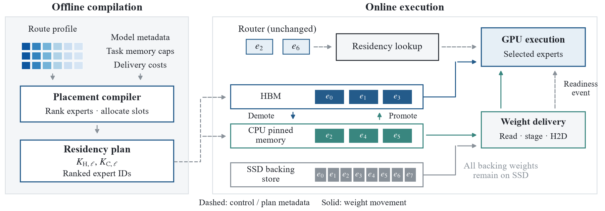
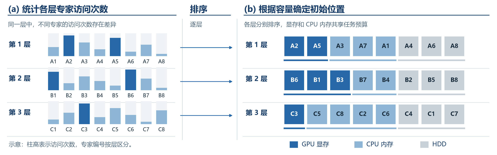
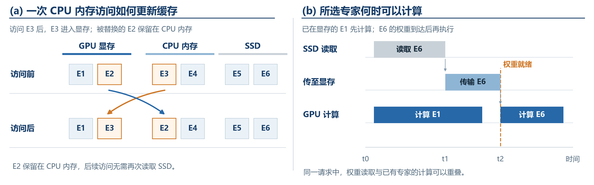

# 一张 GPU 如何运行完整 MoE？

**从专家路由到 MECC 专家缓存编译器**

你向一个大模型提问时，它并不会在每一步都使用全部参数。MoE（混合专家）模型会让路由器为当前 token 挑选少数专家参与计算。这节省了计算，却没有消除存放完整专家权重的需求：下一个 token、下一层或下一个问题，可能选中另一批专家。

**MECC** 的全称是 **MoE Expert Cache Compiler**，即 **MoE 专家缓存编译器**。它研究一张 GPU 和一项推理任务可用的 CPU 内存都不足以容纳完整专家集合时，如何用 HDD 保存完整权重，并把更可能使用的专家留在显存和主存中。其设计跨越两个时间尺度：部署前根据路由画像安排初始位置，运行时根据实际路由更新缓存。

本文从一次 token 的前向计算出发，先解释单卡、多卡和磁盘卸载的区别，再介绍相关工作的动机、方法与实验，最后完整走一遍 MECC 的编译、推理和 A100 实测。你可以单独阅读本文；代码与原始结果的链接只用于进一步核对。

---

## 1. 一个 token 如何经过 MoE

Transformer 的普通前馈层对所有 token 使用同一组参数。MoE 层则准备多个前馈网络，称为**专家**；路由器针对当前 token 的隐藏状态给专家打分，只选择其中 `top-k` 个。若第 `l` 层的隐藏状态为 `h_l`，计算可写为：

```text
分数：       score[l, e] = router_l(h_l)[e]
选中专家：   S_l = top-k(score[l, :])
层的输出：   y_l = Σ_(e∈S_l) gate[l, e] × expert[l, e](h_l)
```

这产生了 MoE 的关键特征：**本次计算稀疏，模型权重仍然庞大**。当前 token 只用两三个专家，不代表下一 token、下一层或下一个问题也用它们。服务系统必须随时能取到被路由器选中的原专家。Mixtral-8×7B 是这个问题的直观例子：32 个 MoE 层，每层 8 个专家，专家对象总数为 256。[Mixtral 模型论文](https://arxiv.org/abs/2401.04088)

专家的唯一名字是“层号＋专家号”。下表把三层分别记为 A、B、C，避免把不同层同编号的专家误认为同一块权重。

| 当前前向位置 | 路由结果 | 权重所在位置 | 本层怎么做 |
|---|---|---|---|
| 第 1 层 | `A2`、`A5` | GPU、CPU | `A2` 直接算；`A5` 传到 GPU 后算 |
| 第 2 层 | `B1`、`B7` | GPU、HDD | `B1` 直接算；`B7` 从 HDD 读取后再算 |
| 第 3 层 | `C3`、`C6` | CPU、GPU | 按这一层的缓存状态访问，再继续前向 |

每进入一层，都需要**查找**本次路由选中的专家；只有专家尚未在计算位置时才需要搬运。注意力、路由器、KV 缓存、激活和运行时工作区也占显存，不能把一张 A100 的全部显存都分配给专家。

### 1.1 为什么“一张卡”改变了问题

“单卡还是多卡”并不能单独决定是否读取 HDD。真正起作用的是专家权重与**该任务可用容量**的关系。设专家总大小为 `W_E`，各 GPU 可供专家使用的显存之和为 `B_H`，任务可用的主存为 `B_C`。这里的预算要扣除非专家权重、KV 缓存、激活与运行空间；服务器装有 1 TB 内存，也不意味着一个任务能独占 1 TB。

| 容量情况 | 常见部署路径 | 一次访问主要移动什么 |
|---|---|---|
| `W_E ≤ B_H` | 专家分散驻留在多张 GPU；路由器把 token 送往持有专家的 GPU | 跨卡传 **token 激活值**，通常不搬专家权重 |
| 显存不足、CPU 预算可容纳专家 | 一部分专家在 CPU，需要时送往 GPU；也可选择在 CPU 计算 | CPU→GPU 传专家权重，或在 CPU 执行 |
| 显存与 CPU 预算都不足 | HDD 保存完整专家权重，显存和主存只保留部分缓存 | HDD→CPU→GPU 交付冷专家；命中快层则跳过前面的读取 |

多卡全显存的 [FlashMoE（Aimuyo 等）](https://arxiv.org/abs/2506.04667)针对第一种情况优化跨 GPU 的 token 分发、专家计算与结果合并。它的 8 张 H100 实验研究的是分布式 MoE 算子的执行，不意味着所有多卡系统都会在 CPU 保存完整专家副本。MECC 研究的是第三种情况在单 GPU 上的表现；第二种情况中的 CPU→GPU 传输问题也存在，但它不需要 HDD 这一级缓存。

一次 HDD 未命中的访问路径是：

```text
路由器选中专家 → 查找 GPU 缓存 → 查找 CPU 缓存
                                  ↓ 均未命中
                     HDD 读取 → CPU 缓冲 → GPU 传输 → 原专家计算
```

因此单卡推理的目标不是改变模型答案，而是让**等待专家权重**尽量少地出现在生成路径上。共享服务器尤其适合这个问题：宿主机即使有约 1 TB 主存，单个推理任务也可能只获分配几十 GB。MECC 根据任务额度做计划，而不是假设整台服务器只运行这一项任务。

**把问题压缩成一句话：** 一张 GPU 如何在有限显存和主存下，持续执行路由器选中的完整 MoE 专家，并尽量减少 HDD 读取？

### 1.2 多卡究竟如何分工

多卡部署不是一种固定算法。常见的几种并行方式会移动不同的对象，也解决不同的容量问题：[Megatron Core 并行策略指南](https://docs.nvidia.com/megatron-core/developer-guide/latest/user-guide/parallelism-guide.html)。

| 方式 | 各卡主要保存什么 | 推理时主要交换什么 |
|---|---|---|
| 数据并行 | 每卡一份模型副本，处理不同请求 | 一次独立请求通常不需要跨卡路由；提升并发能力，但不增加单份模型可用的显存 |
| 张量并行 | 同一层矩阵分成多个分片 | 每层计算中的部分结果需要合并 |
| 流水线并行 | 不同卡负责不同层段 | 层段之间传递激活值 |
| 专家并行 | 同一 MoE 层的不同专家分布在不同卡 | 按路由把 token 发给持有专家的卡，再收集结果 |

专家并行最能说明为什么“多卡”不等于“CPU 留一份完整专家副本”。当各卡显存加起来足以容纳专家时，权重可以留在所属 GPU，移动的是 token 激活值。[Megatron Core 的 token dispatcher](https://docs.nvidia.com/megatron-core/developer-guide/latest/apidocs/core/core.transformer.moe.token_dispatcher.html)明确把 token dispatch 与 combine 实现为专家并行的跨卡通信。如果连多卡总显存都不够，才需要再结合 CPU 或磁盘卸载；此时要移动的可能变成专家权重，性能瓶颈也随之改变。

## 2. 已有工作分别从哪里切入

这一领域有几条互补路线：控制模型占用、选择 CPU/GPU 执行位置、预测未来要用的专家、提高批处理流水效率、优化磁盘到显存的数据交付，以及设计专家替换规则。理解一篇系统论文，先问它**遇到哪种容量条件**，再看它具体优化的是权重搬运、token 通信还是专家计算。下面逐篇介绍其动机、机制与实验；各论文的加速比只对应其原有硬件、模型、输入和基线。

### SwapMoE：有限内存里保留一组可用专家

**动机。** 参数量增长快于设备内存；直接交换权重增加等待。**机制。** 维护一组 Virtual Experts，并管理其与实际专家的映射，让内存占用可以随预算调整。**实验。** 原论文以 Switch Transformer 的文本摘要为例，报告内存 **14.2→4.7 GiB**、延迟约减半，Rouge-2 同时下降 **0.041**。它展示了内存、速度和质量之间的权衡。[SwapMoE](https://arxiv.org/abs/2308.15030)

MECC 的相应问题是：当专家完整权重保存在 HDD，CPU 里的一组专家如果固定不变，会怎样影响后续重复访问？我们的 A100 对照用 fp16 权重实现了“静态 CPU 池＋GPU 动态缓存”这一机制。

### Fiddler：选择让 CPU 算，还是搬到 GPU 算

**动机。** GPU 显存不足时，传输整个专家权重很贵；有时传输激活并在 CPU 上计算更合适。**机制。** 针对输入规模、生成方式和硬件，选择 CPU/GPU 专家执行方案。**实验。** ICLR 2025 版使用 Mixtral-8×7B，两套平台包括 Quadro RTX 6000 24 GiB＋Xeon Gold 6126、RTX 6000 Ada 约 48 GiB＋Xeon Platinum 8480+；论文对其所测基线报告单批 **1.26×**、长 prefill **1.30×**、beam search **11.57×** 加速。[Fiddler](https://proceedings.iclr.cc/paper_files/paper/2025/file/8cd1ce03ea58b3d7dfd809e4d42f08ea-Paper-Conference.pdf)

Fiddler 关注**在哪里计算**。MECC 关注在任务预算内**保留哪些专家权重**；这两个决策也可以共同设计。

### MoE-Infinity：利用请求内反复出现的路由模式

**动机。** 个人设备上常见单请求、batch=1 的生成过程，专家激活具有可利用的稀疏性。**机制。** 从路由激活轨迹中选择代表模式，指导专家缓存替换和预取。**实验。** 论文使用 DeepSeek、Mixtral 及多类任务，对 vLLM、Ollama、DeepSpeed 和 BrainStorm 等系统报告 **3.1—16.7×** 的每 token 延迟改善。[MoE-Infinity](https://arxiv.org/abs/2401.14361)

这项工作让我们看到：路由历史本身是一种系统信号。MECC 把这类信号放进“部署前初态＋运行时更新”的两阶段框架里。

### MoE-Lightning：让 CPU、GPU 和 I/O 连续工作

**动机。** 离线批量生成时，计算与权重搬运如果交替等待，设备吞吐会很低。**机制。** CGOPipe 组织 CPU/GPU/I/O 流水，并用分层 Roofline 性能模型选择高吞吐配置。**实验。** ASPLOS 2025 版的单卡平台是 T4 16 GB 或 L4 24 GB，搭配 192 GB 主存，模型为 Mixtral-8×7B；多卡实验还覆盖 Mixtral-8×22B 和 DBRX。MTBench 输出长度为 32、64、128、256 token，另有 HELM 推理与摘要任务。论文对其批处理基线报告最高 **10.3× 吞吐**。[MoE-Lightning](https://pschafhalter.com/papers/2025-asplos-moe-lightning.pdf)

MoE-Lightning 的主要度量是**批吞吐**，MECC 的当前主实验主要考察单卡专家驻留和每 token 延迟。二者说明“让设备忙起来”和“减少冷读取”是两个可以叠加的问题。

### SSD-LLaMA：从磁盘到显存的完整专家交付

**动机。** 超大 MoE 模型的完整专家池超出消费级显存与主存。**机制。** 原论文设计磁盘 I/O 管线、磁盘—主存—显存三级保留，以及 CPU/GPU 专家执行分工；每个被路由选中的专家都会执行。**实验。** 其测试机为 RTX 5090 32 GB、Intel Ultra5 230F、16 GB RAM 和 4 TB NVMe，batch=1；模型为量化的 DeepSeek-V4-Flash、Kimi-K2.7-Code 与 GLM-5.2，任务包括 MMLU 和 Alpaca。论文报告 prefill **1.52—4.19×**、decode **2.10—15.58×** 的所测基线加速，并在单张 RTX 5090 上报告万亿参数模型超过 1 token/s。[SSD-LLaMA](https://arxiv.org/abs/2609.18110)

这篇论文的名字和设备配置沿用原文。MECC 当前研究的是**HDD 场景下**，任务预算、逐层初始位置和两级热缓存联动如何影响冷读取。

### FlashMoE：用访问特征决定谁离开缓存

**动机。** 简单 LRU 只记“最近使用”，不能充分利用专家访问频率。**机制。** 从最近性与频率构造特征，训练轻量预测器选择淘汰对象。**实验。** 论文使用 RTX 5070 Ti 16 GB、Ryzen 5 9600X 和 64 GB 装机主存，实验把可用主存压到约 1 GB；模型包括 OLMoE-1B-7B 与 Qwen3-30B-A3B。原文对所测系统报告最高 **2.6×** 加速，缓存命中率相对常见策略最高提升 **51%**。[FlashMoE](https://arxiv.org/abs/2601.17063)

它提示我们：专家替换策略是持续可优化的部分。项目里的 `flashmoe_rf_adaptation` 是把公开的最近性/频率特征移植到统一实验框架中的本地对照。

### MoE-CORE：按层分配缓存并协调预取

**动机。** 不同 MoE 层的热点程度不同，统一分配专家槽位会浪费内存；传输也需要提前安排。**机制。** prefill 时交替装入整层专家；decode 时结合逐层容量、任务画像、路由历史与跨层预取。**实验。** 论文在 Ascend 950PR 上，将 NPU 内存限制为 84 GB、主存限制为 150 GB，评估 DeepSeek-V4-Flash-W4A8 与 GLM-5.2-W4A8C8，任务覆盖 GSM8K、HumanEval、MMLU 等；对按需加载对照，DeepSeek 的 TPOT 改善约 **1.39—1.75×**。[MoE-CORE](https://arxiv.org/abs/2610.01950)

这项工作说明**逐层差异**值得显式建模。MECC 的画像也按层记录，部署时为每层生成专家排序与缓存槽位。

### 同名的另一篇 FlashMoE：让多卡之间少等待

Aimuyo 等人的 [FlashMoE: Fast Distributed MoE in a Single Kernel](https://arxiv.org/abs/2506.04667)与上文 Kim 等人的边端缓存替换系统同名，但处理的是另一条路径。**动机**是多卡全显存部署中的 token 分发、专家计算、结果合并需要反复启动 kernel 与同步；专家虽然已在 GPU 上，设备仍可能等待通信。**方法**是在一个常驻 GPU kernel 中组织分发、计算和合并，并由设备主动发起跨 GPU 通信。**实验**主要使用 8 张 H100，覆盖最多 128 个专家与 16K token 序列，以 Comet、FasterMoE、Megatron-CUTLASS、Megatron-TE 等分布式 MoE 算子为对照，报告单层算子的延迟、吞吐和 GPU 利用率；论文摘要给出所测配置中最高 6× 更低延迟与 5.7× 更高吞吐。它展示了“专家已经驻留在多卡显存”之后还要解决的计算与通信问题，不是 MECC 单卡 HDD 路径的直接性能基线。

### 把原论文的实验放回各自的问题中

下表把容易混淆的实验条件放在同一页。数值均为**各论文在其指定条件下报告的结果**，并非将这些系统搬到同一台 A100 上横向比较。

| 工作 | 测试设备、模型与输入 | 主要基线 | 原论文展示了什么 |
|---|---|---|---|
| [SwapMoE](https://arxiv.org/abs/2308.15030) | Jetson Nano／AGX Orin；Switch Transformer、GPTSAN；SAMSum、日文语言建模 | 原模型、按需加载、剪枝 | Switch 摘要示例中，内存 14.2→4.7 GiB，延迟约减半，Rouge-2 下降 0.041；展示内存、延迟与质量的取舍 |
| [Fiddler](https://arxiv.org/abs/2402.07033) | Quadro RTX 6000／RTX 6000 Ada；fp16 Mixtral-8×7B；ShareGPT 的单请求、长 prefill、beam search | DeepSpeed-MII、Mixtral-Offloading、llama.cpp | 单请求 1.26×、长 prefill 1.30×、beam search 11.57×，三者是不同负载的结果 |
| [MoE-Infinity](https://arxiv.org/abs/2401.14361) | 单张 RTX A5000；Switch、NLLB、DeepSeek、Mixtral 等；BIGBench、FLAN、MMLU | DeepSpeed、Ollama／llama.cpp、Mixtral-Offloading 等 | 在论文所测模型与对照中，每 token 延迟改善 3.1—16.7×；主存可容纳完整模型 |
| [MoE-Lightning](https://pschafhalter.com/papers/2025-asplos-moe-lightning.pdf) | T4／L4 单卡和 2—4 张 T4；Mixtral-8×7B／8×22B、DBRX；MTBench、HELM | FlexGen、FlexGen(c)、DeepSpeed Zero-Inference | 所测批处理配置中最高 10.3× 吞吐；关注批量生成，而非单请求 TPOT |
| [SSD-LLaMA](https://arxiv.org/abs/2609.18110) | RTX 5090 32 GB、16 GB 主存、NVMe；三类量化 MoE；MMLU、Alpaca | llama.cpp、KTransformers、Colibri | 所测对照下 prefill 1.52—4.19×、decode 2.10—15.58×；研究磁盘原生交付 |
| [FlashMoE：边端缓存](https://arxiv.org/abs/2601.17063) | RTX 5070 Ti 16 GB；OLMoE、Qwen3；TriviaQA | LRU、LFU、ARC、LeCaR 及若干系统 | 相对常见替换策略最高提升 51% 命中率；着重研究淘汰哪位专家 |
| [MoE-CORE](https://arxiv.org/abs/2610.01950) | Ascend 950PR，84 GB 推理内存上限；DeepSeek、GLM；GSM8K、MMLU 等 | Load on Demand、vLLM Prefetch | DeepSeek 五种负载下平均 TPOT 38.0—44.8 ms，展示逐层驻留与预取 |
| [FlashMoE：多卡算子](https://arxiv.org/abs/2506.04667) | 8 张 H100；最多 128 专家、16K token；单层 MoE 算子 | Comet、FasterMoE、Megatron 系列 | 所测配置最高 6× 更低延迟、5.7× 更高吞吐；优化跨卡通信和 kernel 调度 |

如果需要逐项核对实验配置、benchmark 划分和图表指标，可继续读[相关工作实验详解](./MECC_相关工作实验与洞察详解.md)；本文其余部分会沿着“专家权重到底在哪里”的问题回到 MECC。

## 3. 单卡部署会连续遇到三个问题

这三个问题沿一次服务的时间线出现：先决定缓存初态，再处理重复访问，最后面对任务变化。

**① 第一次请求：热专家放在哪里？** 如果首次路由选中的专家位于 HDD，首 token 要等待读取和传输。多卡全显存部署通常能直接取得专家；单卡需要把有限快层留给最值得提前装载的专家。这是**初始放置**问题。

**② 接下来生成：为什么同一个专家又从 HDD 读取？** 第一次访问把专家带进显存，后续访问又可能把它挤走。如果 CPU 缓存独立且固定，显存被替换的专家未必能留下；下一次路由再次选中它时，又产生一次 HDD 读取。这是**两级缓存协同**问题。

**③ 请求类型改变：原本的热门专家还热门吗？** 问答任务与代码任务可能激活不同专家。部署前的热度画像提供好的起点；系统还需要根据当前请求更新驻留顺序，使新任务常用的专家逐步进入显存和主存。这是**在线适应**问题。

三者合起来就是 MECC 的设计线索：**先安排起点，再减少重复搬运，最后跟随路由变化。**

## 4. MECC 总览：编译一次，运行时持续更新

MECC 的整体工作过程可以拆成两个阶段：



*图 1：MECC 框架。图中的 HBM 是 GPU 显存，CPU pinned memory 是固定内存中的专家缓存，HDD backing store 保存完整权重。虚线表示放置计划或就绪信号，实线表示权重移动。*

```text
部署前
代表性输入 ─→ 逐层专家访问计数 ─→ 热度排序 ─┐
模型权重   ─→ 每个专家的大小与位置 ────────────┼─→ 编译计划
任务预算   ─→ 可用 GPU/CPU 专家缓存容量 ────────┘

运行时
输入 prompt ─→ 每层路由 ─→ 专家查找 ─→ HDD/CPU/GPU 交付
                                  └─→ 执行原专家 ─→ 更新缓存 ─→ 下一层/下一 token
```

编译计划包含每层的缓存容量 `K_H,l`、`K_C,l` 和按热度排列的专家编号。HDD 保存完整专家权重；GPU 与 CPU 保留热副本。计划决定**初态**，运行时状态则由每次实际路由推动。

### 4.1 Method I：从画像生成初始放置

用代表性输入运行模型，累计 `count[l,e]`，表示第 `l` 层专家 `e` 被激活的次数。编译器将各层专家排序，再在任务的显存和主存预算内确定初始驻留：高频专家先入 GPU，其后放 CPU，其他专家保留在 HDD。若有各层访问偏斜信息，编译器还可以给不同层分配不同数量的槽位。[编译配置代码](../../e2e/compile_config.py)

为什么按层做？因为第 1 层的 `A2` 与第 2 层的 `B2` 互不相同，访问频率也不同。一个全模型的“专家 2”排名没有定义。用 Zipf 模型表示热度时，前 `k` 个专家的预计访问质量为 `H(k,α)/H(N,α)`；`α` 越大，热点越集中。这个公式帮助估算给一层多加一个缓存槽能节省多少读取。[形式化说明](../../../docs/THEORY.md)

**例子。** 某层排序为 `A2 > A5 > A1 > A7 > …`，该层有两个 GPU 槽、两个 CPU 槽，那么初始位置为 GPU `{A2,A5}`，CPU `{A1,A7}`。每层都独立形成这样的排序。



*图 2：专家编号带层前缀。右侧每行只表示该层的初态；实际推理会继续更新。*

### 4.2 Method II：一次专家访问如何更新两级缓存

MECC 的运行期核心是 GPU 与 CPU 的联合动态缓存。[缓存策略代码](../../e2e/policy_plugin.py)

| 访问前的专家位置 | 本次动作 | 访问后的变化 |
|---|---|---|
| GPU | 直接计算 | 更新 GPU 最近使用顺序 |
| CPU | 传入 GPU 后计算 | 专家进入 GPU；被替换的 GPU 专家进入 CPU |
| HDD | 读到 CPU 缓冲，再传入 GPU 计算 | 专家进入热缓存；容量满时逐级替换 |

联合更新的关键是**降级**：GPU 腾出的专家先进入 CPU，而不是立刻失去热副本。与之对称，CPU 命中的专家可以**升级**回 GPU。CPU 缓存容量满时，最旧的热副本被淘汰；HDD 中的完整权重仍可在下次需要时读取。[缓存引擎代码](../../e2e/tiered_engine.py)



*图 3：左侧是缓存状态变化，右侧是同一请求中权重交付与专家计算的先后关系。*

### 4.3 Insight III：让实际路由改写缓存顺序

部署前画像给出一份排序，在线路由不断提供新证据。MECC 不修改模型路由器，也不改路由器选择的专家；它根据真实访问更新最近使用顺序。任务变化后，新任务常用的专家经过若干次访问进入 GPU/CPU，旧热点逐步退出。这样，静态计划和动态访问各负责一个时间尺度。

## 5. 跟着一条 prompt，走完 MECC 的生命周期

假设用户输入：“请解释一段 Python 程序为什么超时。”我们用三层缩小模型说明全过程；实际 Mixtral 有更多层。

1. **部署前画像。** 在预先选定的请求集合上执行模型，记录 `A2`、`B7`、`C3` 等专家的路由次数。编译器按层排序，生成每层 `K_H,l/K_C,l` 和初始驻留名单。
2. **构造权重存储。** 每个专家以 `(层号, 专家号)` 识别，完整权重写入 HDD store；manifest 记录模型与权重版本。GPU 和 CPU 装载初始热专家。
3. **第一个 token 的第 1 层。** 路由器选择 `A2,A7`。`A2` 已在 GPU，直接算；`A7` 在 CPU，传入 GPU。腾出的 GPU 专家降入 CPU。
4. **第 2 层。** 路由器选择 `B1,B6`。`B1` 在 GPU；`B6` 仅在 HDD。系统读入 `B6`，传到 GPU，运行它原有的前馈权重，按路由系数合并两位专家的输出。
5. **第 3 层与下一 token。** 每层重复“路由—查找—交付—计算—更新”。下一 token 再经过所有层，但缓存状态已因上一 token 改变，很多重复访问转为 GPU/CPU 命中。
6. **下一个任务。** 若后续请求变成数学问答，新的常用专家逐渐占据热层。系统继续使用同一份完整权重和同一套访问规则。

这条时间线回答了常见疑问：**每层都会查找专家，但并非每层都会搬运；编译期按层统计热度，运行期按实际路由更新位置。**

## 6. 怎么读实验结果

分析一个推理系统时，应把**首 token 等待、后续生成间隔、冷层读取比例和输出质量**分开看。下面使用仓库中已落盘的 A100 结果，给这些指标一个具体尺度。

### 6.1 单卡 A100：完整 Mixtral 的一次运行

主实验采用单张 A100 80 GB、Mixtral-8×7B、专家缓存显存预算 50 GB、CPU 预算 40 GB。输入为 8 条 WikiText-2 请求，每条最多生成 64 token；PPL 使用 1024-token 的 WikiText-2 片段。运行时完整专家由 HDD 逻辑存储提供。每个策略独立运行一次，以下是可直接从 `result.json` 复算的观测。[主实验来源](../../../docs/PROVENANCE.md)

| 本地策略 | TPOT（秒/token） | TTFT（秒） | 这行回答的问题 |
|---|---:|---:|---|
| naive | 13.04 | 156.86 | 朴素单卡权重交付需要多久？ |
| swapmoe | 21.75 | 174.19 | CPU 专家池固定时会怎样？ |
| ours | **7.38** | **139.14** | GPU/CPU 联合更新后的表现 |
| ours_io | 7.78 | 139.80 | 少了部分交付优化会怎样？ |
| flashmoe_rf_adaptation | **7.19** | 101.76 | 最近性＋频率替换能达到什么水平？ |
| fiddler | 8.26 | 398.45 | 把部分专家放到 CPU 计算会怎样？ |

在这组单次运行中，MECC 的每 token 延迟相对本地静态 CPU 池对照约降低到 **1/2.95**，相对 naive 降到 **1/1.77**。最近性＋频率的本地适配在本组数据中为 **7.19 秒/token**，表明替换策略仍有进一步研究空间。五个精确专家执行路径的 PPL 都约为 **3.427**；`fiddler` 路径为 **3.432**。

读这张表时把三个指标分开：**TTFT** 是首 token 等待，**TPOT** 是后续 token 平均间隔，**PPL** 是给定文本的语言建模指标。一次完整请求还应结合 prompt 长度、输出长度与生成 token 总数来评价。[原始结果目录](../../results/runs/)

### 6.2 为什么联合缓存有作用

本地独立缓存消融在同样的 50/40 GB 配置与 8×64 输入规模下，TPOT 为 **32.94 秒/token**；联合缓存的 MECC 为 **7.38 秒/token**。两者的全阶段冷层访问计数占比分别为 **47.9%** 和 **12.5%**。这张图最适合与第 4.2 节的“GPU 淘汰专家降入 CPU”状态转移一起看。[消融来源](../../../docs/PROVENANCE.md)

### 6.3 可用 CPU 内存决定冷读取有多频繁

同一 WikiText-2 输入来源、显存预算 50 GB 的两档单次观测中，MECC 的 CPU 预算从 **30 GB** 提高到 **60 GB**，TPOT 从 **14.46** 降到 **0.76 秒/token**。当热层足以容纳全部专家时，专家权重不再频繁访问 HDD。这个结果把“任务获得多少主存”与实际生成体验直接联系起来。[预算实验来源](../../../docs/PROVENANCE.md)

### 6.4 如何比较不同论文的实验

先确认模型及权重精度，再确认每张 GPU 和每个任务实际分到的显存、主存与冷存储；随后看请求来源、prompt 和输出长度、批大小。最后才看指标：TTFT 反映首次等待，TPOT 反映后续生成，tok/s 还受计时窗口影响，冷层访问比例通常不能单独代表端到端时间。多卡全显存算子的延迟、单卡完整模型的 TPOT、批处理总吞吐回答的是不同问题。若要比较 MECC 与另一项方案，最好在同模型、同权重格式和同任务预算下运行两者。

## 7. 给专家的三条主线

**模型主线。** 先看路由器为每层选了哪些原专家，再看这些权重怎样到达计算设备。稀疏激活解释了“为什么可以缓存”，完整专家集合解释了“为什么需要 HDD”。

**系统主线。** 部署前的画像决定缓存初态；运行时联合更新管理 GPU/CPU 驻留；真实路由推动任务变化后的缓存迁移。这三项分别作用于首次访问、重复访问和长期访问分布。

**实验主线。** 主性能看 TTFT/TPOT；机制解释看各阶段冷读取与缓存状态；质量看相同权重和输入的 PPL/logits；资源取舍看任务预算与 GPU 数量。把每个柱高对应到这条主线，图才容易读懂。

## 8. 四个容易混淆的问题

**模型已经在多卡上，为什么还会慢？** 全显存多卡跳过了专家权重的 HDD 读取，却仍要跨卡路由 token、同步结果并调度 GPU 算子。分布式 FlashMoE 研究的正是这段路径。只有在所需专家不在任何可用 GPU 显存时，才进入 CPU／磁盘权重卸载问题。

**CPU 有 1 TB，为什么还研究 HDD？** 服务器内存容量不等于单个推理任务的预算。其他任务、数据库缓存和系统进程都要占内存；一个任务只分到几十 GB 时，专家集合仍可能超过它的可用主存。

**每层都有“专家 2”，为什么不能全局排一次名？** 第 1 层的 `A2` 与第 2 层的 `B2` 是不同权重对象，它们的路由频率也不同。编译器和运行时都以“层号＋专家号”定位对象。

**缓存命中率提高，就一定更快吗？** 不一定。迁移、HDD 读请求合并、CPU 固定内存、计算与传输重叠都会影响实际等待时间。因此本文将冷层访问、TPOT 和 TTFT 分别报告。

## 9. 顺着代码复现一次思考过程

1. 打开 [`compile_config.py`](../../e2e/compile_config.py)，找到读取逐层访问计数、计算 `K_H/K_C` 和输出 `placement` 的位置。用纸画出某一层 8 个专家在 2 个 GPU 槽、2 个 CPU 槽下的初态。
2. 打开 [`policy_plugin.py`](../../e2e/policy_plugin.py) 的 `OursPolicy.access`，跟踪一个 GPU 命中、一个 CPU 命中和一个 HDD 未命中；再到 [`tiered_engine.py`](../../e2e/tiered_engine.py) 看淘汰时的降级。
3. 打开 [`run_e2e.py`](../../e2e/run_e2e.py) 和[主实验结果目录](../../results/runs/)，选 `a100-main-ours-20261104` 与 `a100-main-swapmoe-20261104` 的 `result.json`，用 TPOT 计算 `21.75165/7.38198≈2.95`。
4. 再看[实验溯源表](../../../docs/PROVENANCE.md)与[相关工作复现审计](../../../docs/RELATED_WORK_REPRO_AUDIT.md)，把每个本地策略映射到它实际实现的机制。

读完代码后，可以自己画两张图：一张标出一个 token 穿过三个 MoE 层时每层选中的专家；另一张标出其中一个 CPU 命中和一个 HDD 未命中如何改变 GPU／CPU 缓存。两张图连起来，就是 MECC 的完整生命周期。
