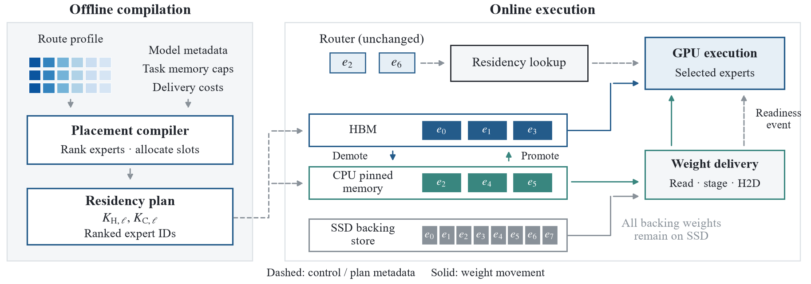
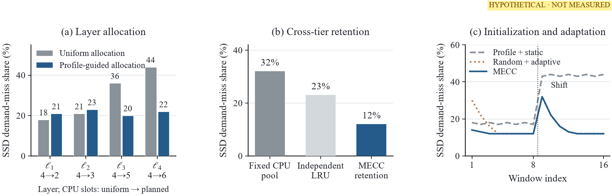
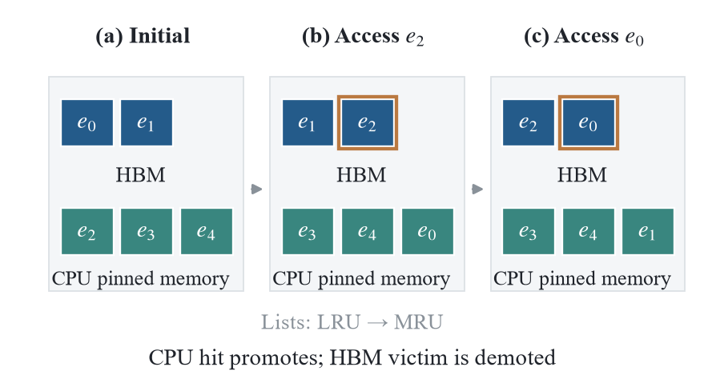
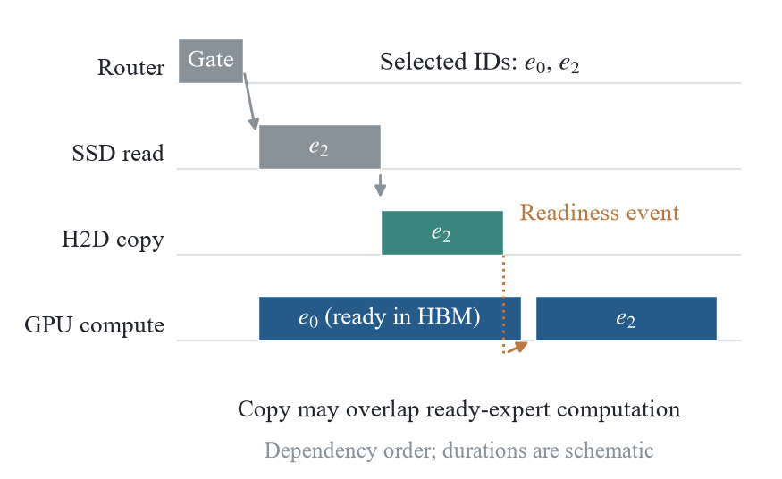
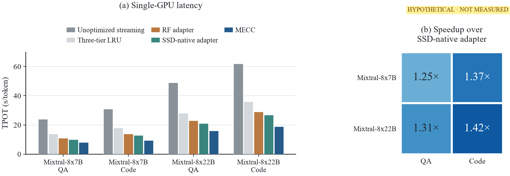
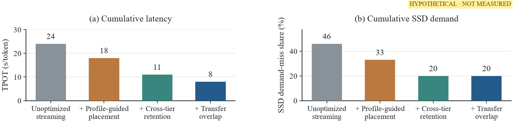
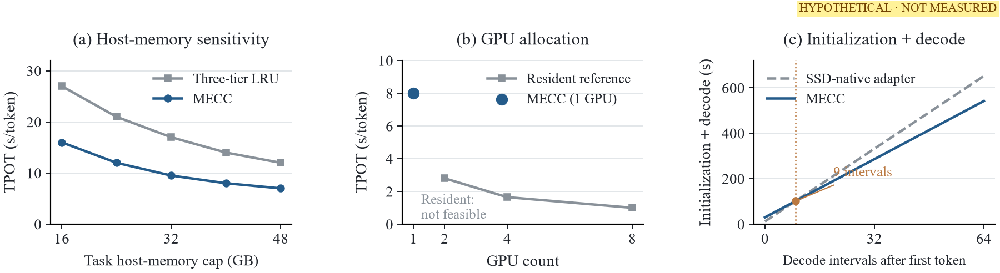

# 从零读懂 MECC：让一张 GPU 有条理地使用放不下的模型

这份文档配合当前的 [英文论文](./mecc_dac2027_polished.pdf) 阅读。你不需要先懂计算机体系结构、缓存算法或论文中的数学公式。我们先建立直觉，再看具体操作，最后解释每张图究竟在回答什么问题。

> **先认识这份论文的状态**：当前版本是一份带有理想结果的设计稿。图中的速度、未命中比例和资源曲线是人为设定的目标，并非本轮完成的实验。本文把它们当作“学习如何阅读实验的例子”，不会把目标写成已经实现的成绩。黄色标注提示虚拟结果或待补内容；浅蓝色标注是 AI 使用说明。

## 阅读路线

第一次阅读，先看第 1—5 节，理解“为什么需要这个系统、它怎样工作”。接着看第 6—10 节，把方法和论文中的图对应起来。第 11—14 节帮助你理解实验是否有说服力，以及怎样向别人解释这项工作。

## 1. 先用一个图书馆故事理解问题

想象你正在写一篇报告，需要不断查阅很多本工具书。

- **桌面**很小，但拿书最快。
- **身后的书架**稍大，取书要起身，速度慢一些。
- **远处的书库**能保存完整藏书，但每次往返都要花时间。

你不可能把所有书摊在桌上，也不必这样做。当前用到哪本，就把它放到手边；暂时不用的书，可以留在书架或书库。

这时，效率主要取决于三件事：哪些书先放在桌上；用过的书被移走后放在哪里；取下一本书时，能不能继续处理手边已经有的材料。

MECC 研究的就是相似的问题。论文里的“书”是一块块模型专家权重；“桌面、书架、书库”对应 GPU 显存、CPU 内存和 SSD。

这个比喻有一个重要的对应关系：**搬书没有改写书里的内容。** MECC 希望改变的是权重的存放位置和交付方式，而不是模型本身的知识或专家选择规则。

## 2. 读论文前，需要认识的几个对象

### 2.1 模型、权重和推理是什么？

语言模型可以粗略理解为一个很大的数值计算程序。它接收已经出现的文字，计算接下来可能出现什么。

训练过程中学到的大量数值叫作**参数**，推理时参与计算的这些数值通常也称为**权重**。权重需要保存在存储设备里；参与 GPU 计算时，相应权重需要在 GPU 能使用的位置准备好。

**推理**就是使用已经训练好的权重回答问题。本论文研究的是推理期间如何存放和搬运权重，不是在研究怎样训练模型。

### 2.2 Token 不是严格意义上的“一个汉字”

模型处理文字时，会先把文字切成 token。一个 token 可能是一个词、词的一部分、一个字或其他片段，具体由分词器决定。

因此，论文中的“每 token 耗时”不能直接理解为“每生成一个汉字耗时”。比较不同系统时，要使用相同的模型、分词器和输入。

### 2.3 MoE 为什么既“大”又“稀疏”？

MoE 是 Mixture of Experts，即混合专家模型。它在一些模型层里准备多组专家，通过一个路由器决定当前 token 使用哪些专家。

这里的“专家”是模型里的权重和计算模块，不是一个独立聊天机器人。路由器也是模型的一部分。

例如，**仅作结构教学的例子**：某一层有 8 个专家，每个 token 选择其中 2 个执行。该层一次没有执行另外 6 个专家，但后面的 token 仍可能用到它们，所以通常还要保存它们的权重。

这就产生了一个矛盾：

> 一次计算只用一部分专家，存储却要为整个专家集合做好准备。

还有两点容易看错：一次选择通常发生在具体的模型层里，不是整段回答只选一次；不同层即使都叫“专家 0”，也不是同一份权重。一个专家的完整身份包括**层号和专家号**。

### 2.4 GPU、HBM、CPU 内存和 SSD 各自做什么？

| 名称 | 在这里的含义 | 图书馆比喻 |
|---|---|---|
| GPU | 执行模型计算的加速器 | 正在处理材料的工作者 |
| HBM | 本文 GPU 使用的高带宽显存，存放计算所需的数据 | 桌面 |
| CPU 内存 / 主存 | 主机上的内存，可以缓存专家，也可以作为传输暂存区 | 身后的书架 |
| CPU pinned memory | 经过页锁定处理、适合相关异步传输路径使用的主存区域 | 为搬运做好准备的书架区域 |
| SSD | 保存完整专家权重的底层存储设备 | 完整书库 |

CPU 内存和 GPU 显存不是同一个池子。权重在 CPU 内存里，不代表 GPU 已经可以立即用它执行计算；还需要考虑主机到设备的传输。

另外，本论文所描述的主要路径是**GPU 执行选中的专家**。CPU 在这里主要承担权重缓存和暂存作用。不要把它与“把部分专家直接放到 CPU 上计算”的其他方案混为一谈。

### 2.5 显存里不只有专家权重

GPU 还需要保存非专家部分的权重、中间计算结果、KV 缓存和各种缓冲区。

KV 缓存可以粗略理解为模型为了后续生成而保留的注意力相关信息。它与专家权重是两种不同的数据。优化专家缓存，不代表 KV 缓存就不占空间了。

所以，“GPU 有多少显存”与“能给专家缓存分多少显存”是两个不同的问题。

## 3. MECC 到底想解决什么？

MECC 全称是 **MoE Expert Cache Compiler**，可以理解为“为 MoE 专家缓存生成放置计划的系统”。

它要回答的问题是：

> 当一个推理任务的显存和主存不足以长期保留完整专家集合时，怎样减少 SSD 取数造成的等待，同时保持原来的专家和权重？

### 3.1 为什么不能只看服务器的物理内存？

一台服务器有多少主存，并不等于某个任务一定能使用多少主存。

例如，**假设的资源分配场景**：服务器有 1TB 主存，但某个服务实际只获得其中一部分额度。分析这个服务时，应使用它真正可以占用的额度，而不是把整台服务器的主存都算给它。

这不意味着“共享服务器就一定需要 SSD”。如果任务获得的内存足够大，完整模型可以长期驻留，SSD 层可能没有持续发挥作用。

### 3.2 什么情况下，三级缓存才真正遇到要解决的瓶颈？

先分清三种部署状态：

| 状态 | 主要问题 |
|---|---|
| 模型可以放进 GPU 显存 | 不需要靠 SSD 交付专家来解决容量问题 |
| 放不进显存，但主存可以容纳 | 主要研究 GPU—CPU 两级的放置与传输 |
| 任务主存也不足，专家集合无法完整保留在快层与中间层 | 部分需求可能到达 SSD，三级管理开始有直接研究对象 |

本项目把“专家集合超过任务可用主存”作为重要的定位条件。做具体部署时，还必须扣除重复镜像、暂存区和其他数据，检查 **HBM 与主存能覆盖的不同专家总量**。专家超过主存，并不单独证明它超过两级的合计唯一覆盖能力。

当前论文进一步要求检查：初始化结束后，是否仍有真实的 SSD 需求和物理读取。模型刚启动时从磁盘加载过一次，不能据此证明后续推理一直受到 SSD 限制。

### 3.3 这是否等于“一张 A100 能轻松跑任意大模型”？

不能这样推断。至少要分别检查：完整权重是否有足够的底层存储空间；一次计算所需的权重、激活和缓冲区能否放入显存；最后的等待时间是否符合使用需求。

本设计中的 SSD 保存完整权重，快层又保存部分副本。因此，不能简单把 HBM、主存、SSD 的空闲容量相加，就当作能够部署的模型大小。

“能够保存权重”“能够正确完成计算”和“速度足够好用”是三个要分别验证的问题。

## 4. 先看框架：运行前做计划，运行时处理真实请求



这就是论文 **Overview** 章节中的框架图。先从左往右看，不必立即理解所有标号。

### 4.1 左边：离线编译

“离线”表示这项工作发生在所考察的在线服务之前，不是每产生一个 token 都重新做一次。

系统先观察一组独立样本，统计各层专家的选择情况。这个过程叫作**画像**，英文是 profile。它回答的是“哪些专家过去经常被用到”，并不保证后面一定重复相同的访问。

接着结合模型信息、任务内存额度以及交付成本，生成一份**驻留计划**：每层有多少个 HBM 槽位、多少个 CPU 槽位，以及启动时优先放哪些专家。

这里的“编译器”主要指把画像和资源条件变成可执行的放置计划。不要仅凭这个名字，就把它理解为一个重新生成 GPU 计算内核的传统程序编译器。

### 4.2 右边：在线执行

真正开始推理后，原来的路由器给出专家编号。系统根据编号检查权重当前在哪里：已经在 HBM 就使用；在 CPU 内存就传到 GPU；需要从 SSD 获取时，先读入暂存区再传输。

同时，缓存更新最近使用情况。被需要的专家可以上移，显存里被挤出的专家可以下移。

本设计把两个东西分开了：**一层分到多少空间**与**这些空间里此刻放谁**。当前设计在一次运行中保持逐层容量不变，运行时主要改变专家身份和访问顺序，并不是每个请求都重新分配所有层的空间。

### 4.3 图里的线条应该怎样读？

虚线表示控制或计划信息，例如缓存额度、初始专家编号和就绪信号。实线表示权重移动。

SSD 一栏画出完整专家集合，是因为它保留底层权重。某个专家在 HBM 或 CPU 中，不意味着它在 SSD 上的原始副本消失了。

## 5. 三个挑战，分别对应什么办法？



**这张图中的数值和访问窗口都是假设示意。** 它告诉我们该如何检验三个问题，而不是已经证明三个问题都被解决。

### 5.1 空间分给谁：不同层需要一样多的缓存吗？

图 1(a) 用四个代表性层做例子。均匀分配是 `4、4、4、4` 个 CPU 槽位；按画像调整后变为 `2、3、5、6`。两种分配的总槽位相同。

它想表达的是：如果一些层的工作集比较集中，另一些层的需求更分散，把每层的空间强行分得一样多，可能不是合适的选择。

“给后面的层多分空间”不是普遍规律。应根据访问情况做决定。图中前两层失去部分空间，未命中比例反而上升；是否总体有利，还要按真实请求次数计算整体指标。

这对应**逐层容量分配**。

### 5.2 移走以后放哪里：显存淘汰是否一定要丢掉？

图 1(b) 比较不同保留规则。一个刚离开显存的专家，很快可能又会被使用。如果它仍在 CPU 缓存中，就有机会避免重新读 SSD。

另外，如果 GPU 和 CPU 都保存同一专家的副本，它们占用了两份物理空间，却不一定多覆盖一个不同的专家。比较时需要分开统计“不同专家覆盖量”和“重复副本占用量”。

这对应**跨层级保留与升降级**。

### 5.3 过去经常用的，后面还会经常用吗？

图 1(c) 画出一次人为设定的访问变化。开始时用一组专家，后面换了热点。

画像可以帮助系统决定起始状态；在线更新则利用真实请求调整后续状态。画像不准确时，只坚持原来的放置可能吃亏；没有画像时，系统可能要经历一个摸索工作集的过程。

这对应**画像初始化与在线适应**。图中的变化是设计出来的，不能直接当作真实 MoE 一定存在同样漂移的证据。

## 6. 把缓存的升降级完整走一遍

### 6.1 先理解 LRU

LRU 是 Least Recently Used，即“最近最少使用”。空间满了，需要移走一个对象时，它优先选择距离上次使用最久的那个。

它根据“最近是否使用”做决定，不等于统计“历史上总共使用过多少次”。常用的书也可能很久没有再翻，最近刚用的书也可能只用过一次。

### 6.2 一个与论文图 3 对应的串行教学例子



假设某一层的 HBM 能放 2 个专家，CPU 缓存能放 3 个。为了看清规则，这个例子不考虑预取、并发和额外镜像。下面所有列表都按“最久未用 → 最近使用”排列。

| 时刻 | 当前请求 | HBM 内容 | CPU 缓存内容 | 发生了什么？ |
|---|---|---|---|---|
| 初始 | 无 | `e0, e1` | `e2, e3, e4` | 两级共有 5 个不同专家 |
| 第一步 | `e2` | `e1, e2` | `e3, e4, e0` | CPU 中的 e2 上移，HBM 中的 e0 下移 |
| 第二步 | `e0` | `e2, e0` | `e3, e4, e1` | e0 仍在 CPU，取回时不必重新读 SSD |
| 再延伸一步 | `e7` | `e0, e7` | `e4, e1, e2` | 从 SSD 取 e7，e2 下移；CPU 满了，移走 e3 |

关键细节是第一步：先从 CPU 缓存里移除正在上移的 e2，腾出的位置可以接住下移的 e0。

这里的“移除”指离开某一级缓存。它不表示从模型中删除专家。SSD 上仍保存完整权重。

### 6.3 为什么称为“联合”管理？

HBM 的淘汰决定与 CPU 的接纳决定是连在一起的。GPU 不再只顾自己丢掉谁，CPU 也不再只保留一组永远不变的专家。

在论文限制的串行、等大小、无预取模型中，这种分层操作可以与该层合并容量的 LRU 栈对应起来。这个对应有助于建立检查参照。

但它不表示“联合 LRU 对任何请求都比其他策略好”，也不表示它能在运行中自动把某一层的槽位借给另一层。

### 6.4 为什么还要讨论 CPU 镜像？

假如 GPU 中的某份权重在 CPU 里已经有一份镜像，淘汰时就可能避免重新从 GPU 把权重复制回来。这可以减少某些搬运，但镜像本身占主存。

所以要同时考虑两件事：减少传输的收益，以及重复副本带来的容量占用。不能因为两份数据属于同一个专家，就只计算一份物理空间。

## 7. “一边搬，一边算”到底怎么做到？



图 4 中，路由器选择了 e0 和 e2。e0 已经在 HBM，e2 还需要从 SSD 获取。

可以先执行已经准备好的 e0，同时尝试完成 e2 的 SSD 读取和主机到 GPU 的复制。等 e2 真正准备好，再按规定的执行顺序计算 e2。

**不是 GPU 一边读取 e2 尚未准备好的权重，一边用这份不完整的权重算结果。** 重叠发生在不同的、满足依赖条件的工作之间。

### 7.1 H2D、D2H 和就绪事件

| 词语 | 含义 |
|---|---|
| H2D | Host to Device，主机到 GPU 的传输 |
| D2H | Device to Host，GPU 到主机的传输 |
| Readiness event | 标记相关复制已经完成、权重可以被使用的就绪事件 |
| Staging buffer | 为读取或传输临时准备数据的暂存区 |

异步提交复制，只表示“发出了搬运任务”，不表示“已经搬完”。GPU 计算必须等待相应就绪条件。复制没完成前，源缓冲区不能被改写；最后一个使用者没完成前，对应 GPU 权重也不能被错误复用或淘汰。

### 7.2 为什么有了复制流，不一定就变快？

因为系统可能没有足够的独立计算来掩盖搬运。如果能算的专家很快就算完了，而下一份权重还没到，GPU 仍然要等。

另外，当前层的路由结果，不会自动告诉系统下一层将选择谁。提前知道未来专家，需要单独的预测机制和评测，不能把它当成异步复制自带的能力。

论文要通过实验确认的，是**最后暴露在请求关键路径上的等待减少了多少**，不是只证明程序里创建了一个复制流。

## 8. “无损”是什么意思？为什么还要做正确性检查？

MECC 的设计希望保持原来的专家选择、FP16 权重、计算内核和聚合顺序。它通过改变存放位置和搬运方式改善交付，不靠少执行专家或降低权重精度来省空间。

FP16 是一种数值表示格式。“保持 FP16”表示搬运前后仍保存同样的 FP16 权重，不是声称 FP16 与任意其他精度的模型完全相同。

如果这些条件都成立，搬运本身不应改变模型的计算。但是程序仍可能出错：复制还没完成就开始计算；缓冲区过早被复用；拿错了层号对应的权重；并发淘汰时覆盖了正在使用的数据。

因此，论文计划分别检查权重校验值、路由专家编号、模型输出数值、生成 token 和困惑度等。困惑度可以理解为语言模型在固定文本上的一种预测评价指标，不能把它当作所有能力的总成绩。

**权重文件相同，只能支持权重相同；它不能单独证明整个异步执行过程正确。** 当前稿中的零输出差异、零困惑度差异仍是待验证目标。

## 9. 论文里的公式，可以怎样读？

第一次阅读可以先跳过公式。下面只解释它们的任务，不要求你推导。

### 9.1 公式 1：给专家热度排个序

论文用离散 Zipf 分布概括“排名靠前的专家更常被选择”的情况。

| 符号 | 直观含义 |
|---|---|
| `ℓ` | 第几层 |
| `r` | 在这一层热度排名第几 |
| `Nℓ` | 这一层共有多少专家 |
| `qℓ,r` | 在这一层的专家选择中，排名 r 的专家占多大比例 |
| `αℓ` | 这一层的热度有多集中 |

在这个分布中，α 较大时，前几名占比更突出；接近均匀的分布则不容易靠少数热点覆盖大量访问。模型也可以直接使用实际统计的频率，不必强行认定每个分布都严格符合 Zipf。

逐层的 q 与全局概率 p 也不是同一个东西。论文用该层占全部专家选择的份额 w，把它们联系起来：`p = w × q`。这样不会把各层分别加起来等于 1 的分布，直接误当成一个全局分布。

这些数描述的是选择频率，没有包含完整的先后次序。在批量预填充中，多个 token 选择同一个专家，也不一定对应多次独立权重读取，所以还要区别“选了几次”和“取了几次”。

### 9.2 公式 2：频繁访问的东西，值得放得更近

这一式子的直觉是：把每个专家的“被选到的可能性”乘以“从当前位置交付它的代价”，再加总，希望这个数尽量小。

同时要满足容量限制：不能给 HBM 和 CPU 分配超过它们预算的权重。

在等大小对象、固定概率和规定的独立容量条件下，常用对象放更快的位置有一个简单的交换解释：如果更常用的书反而放得更远，把它与近处不常用的书交换，就不会增加平均取书代价。

这只是特定静态模型的结论。它没有证明“任意大小、任意请求顺序、任意迁移代价下，当前程序始终最优”。

### 9.3 公式 3：下一格空间分给哪一层？

假设还能多分一个缓存槽位。给不同层的这个槽位，可能覆盖不同数量的访问。论文用“下一名专家的覆盖份额”作为分配评分。

当前描述是先分 HBM 槽位，再分剩余排名中的 CPU 槽位，是一个顺序启发式。“启发式”表示一种可执行、希望有效的选择规则，不等于已经求出了完整问题的全局最优解。

这个覆盖评分也不是完整的延迟收益公式。多覆盖一次访问，实际节省多少时间，还与数据大小、所在层级、传输和同步有关。

### 9.4 公式 4、5：把真实占用的空间加全

主存一侧要考虑 CPU 驻留专家、不同的镜像副本、暂存区和其他相关分配。GPU 一侧还包括非专家权重、KV/激活和缓冲区。

论文中撤回了一个不成立的目标配置：若 HBM 中的 42GB 专家全都在 CPU 保留镜像，镜像就不能只算 6GB，更无法声称这些镜像和其他分配都能放进 40GB 主存额度。

这个例子解释的是核算原则，不是某台机器已经测得的资源结果。真实实验需要记录同时存活的物理分配及各阶段峰值。

## 10. 怎样读懂实验图？

这一节中的所有速度和百分比均来自**当前稿的假设结果**。下面说明：如果将来确实测到了这样的结果，它们分别能支持什么解释。

### 10.1 先认清评价指标

| 指标 | 通俗解释 | 阅读时注意什么？ |
|---|---|---|
| TTFT | 从规定计时起点到第一个输出 token 的时间 | 通常包含预填充和首个输出；加载是否计入需要另行说明 |
| TPOT | 首个输出之后，生成后续 token 的平均时间间隔 | 更接近“后续文字吐出来有多快”，不是整次回答耗时 |
| 吞吐量 | 单位时间完成的 token 或请求数量 | 必须说清分子是什么、有多少请求并行 |
| SSD 需求未命中比例 | 到达时没有就绪 HBM/CPU 权重的专家请求占比 | 计数窗口与分母必须一致；在途预取另外记录 |
| SSD/H2D/D2H 字节数 | 实际从 SSD 读了多少、两个传输方向各搬了多少 | 未命中次数相同，不一定意味着物理流量相同 |
| 内存峰值 | 某阶段同时占用的最大物理空间 | 不能只看最后停在那里剩多少 |

在旧材料里，你可能看到“SSD 命中率”一词。它通常是在说“请求落到了 SSD 这一层”，不是说“快速缓存命中得很好”。当前论文使用 SSD demand-miss share，避免把“读到了底层”误解成好事。

### 10.2 图 5：与谁相比，快了多少？



左边是四组模型/任务的 TPOT 柱状图，越低表示后续 token 间隔越短。QA 表示问答任务，Code 表示代码任务；它们在当前稿中还不是已经冻结的具体数据集。

右边把 MECC 与局部 SSD-native adapter 的 TPOT 比值单独画出来。加速比的计算方向是：

`加速比 = 对照方法耗时 ÷ MECC 耗时`

用第一组**假设值**做算术：未优化流式基线为 24 秒/token，MECC 为 8 秒/token，所以是 `24 ÷ 8 = 3 倍`。局部 SSD-native adapter 为 10 秒/token，则是 `10 ÷ 8 = 1.25 倍`。

两种比较都能算对，但它们回答不同的问题：前者比较整套优化与未优化起点，后者比较更接近的缓存机制。不能只拿较大的 3 倍数字，就声称超过了已有先进系统。

图中的 RF adapter 和 SSD-native adapter 是局部机制适配，不是 FlashMoE、SSD-LLaMA 原系统的正式复现结果。图里没有给出已经验证的外部系统排名。

### 10.3 图 6：加上一个组件，发生了什么？



“消融实验”就是拆开系统，观察某些部分加入或移除后有什么变化。

图 6 的假设过程是：从未优化流式执行的 24，加入画像放置后变为 18，再加入跨层保留变为 11，最后加入重叠变为 8，单位都是秒/token。

它展示的是**按照这个加入顺序产生的累积变化**。不能简单把每一步的差值当成某项技术在所有条件下独立贡献的收益。不同组件可能相互影响，需要额外的单项和组合对照。

右图里最后两项 SSD 需求未命中比例都为 20%。它想检验：重叠是否主要减少等待，而不是减少需求未命中。但还要核对实际字节流量，不能只凭相同的百分比就排除额外搬运。

图 1(b) 中的 12% 属于另一个受控示意，不能与这里的 20% 当作同一组实验的前后值。

### 10.4 图 7：主存、GPU 数量与初始化开销



左图问：给任务更多主存额度，TPOT 如何变化？每个点仍要独立检查镜像、暂存区和实际占用，不能认为画在同一条曲线上就自然满足资源约束。

中图问：单卡方案与完整模型驻留的多卡方案，各占多少 GPU、延迟多大？“Resident reference”表示把模型完整放在 GPU 集合中的参考配置，不需要靠 SSD 持续交付专家。MECC 这里只画了有设计说明的单卡点，没有据此宣称已经实现 MECC 多卡扩展。

右图问：一个方案准备得更慢、后面执行得更快，要经过多少次生成间隔才可能抵消前面的开销？假设的两条线分别是：

```text
MECC：             30 + 8m
SSD-native adapter：12 + 10m
```

m 表示首个 token 之后的生成间隔数。两式在 m = 9 时相等。

这个交点只包含画出来的初始化与后续生成项，没有完整计入两个方案的首 token、画像采集等成本。因此，不能把“九个间隔的交点”直接说成“输出九个 token 后，完整请求就一定更快”。

完整请求通常还要按计时定义组合：

`总时间 = 初始化/摊销成本 + TTFT + (输出 token 数 − 1) × TPOT`

各项不能重复收费，也不能漏掉某个方案的准备工作。

### 10.5 “单卡 8 秒，八卡 1 秒”到底说明什么？

下面全部是当前稿中的**假设部署点，不是实测成绩**：

| 配置 | TPOT | 名义 GPU 时间：卡数 × TPOT |
|---|---:|---:|
| MECC，1 卡 | 8 秒/token | 8 GPU·秒/token |
| 完整驻留参考，2 卡 | 2.8 秒/token | 5.6 GPU·秒/token |
| 完整驻留参考，4 卡 | 1.65 秒/token | 6.6 GPU·秒/token |
| 完整驻留参考，8 卡 | 1 秒/token | 8 GPU·秒/token |

单卡方案减少了同时要分配的 GPU 数量，但用户要等待更久。第一行与第四行的名义 GPU 时间相同，不能据此声称省了八倍电费或算力成本。两卡参考在这个例子中既更快，名义 GPU 时间也更小，所以它必须被列出来。

如果实际只允许分配一张卡，单卡的可部署性可能仍有价值。这与“在所有资源和延迟条件下都更划算”不同。

把 8 秒/token 放到完整回答里也要谨慎：**按这个假设值**，128 个输出 token 对应 127 个后续间隔，仅这些间隔就需要 1016 秒，约 17 分钟，还没加首 token 和其他成本。因此要明确目标是何种离线或可等待的服务。

## 11. 为什么不是画出几根更低的柱子就完成了实验？

好的系统实验，需要说明“收益来自哪里”。

### 11.1 同预算，不等于同实际占用

两个系统都被允许用相同主存额度，不代表它们都充分使用了这部分空间。一个对照方法如果没有合理使用自己的缓存，就可能显得特别慢。

所以应同时报告资源上限和实际占用，并核对它们是否用了同样的模型精度、输入、输出长度、执行内核和 SSD 条件。

### 11.2 这几种对照为什么要分开？

| 想研究的问题 | 只改变什么？ | 其他什么要保持相同？ |
|---|---|---|
| 逐层空间分配是否有帮助 | 各层槽位数 | 总字节、专家排序规则和在线策略 |
| 初始画像是否有帮助 | 起始专家身份 | 各层槽位数、后续请求和在线规则 |
| 跨层保留是否有帮助 | 替换/保留规则 | 容量、起始状态和接纳规则 |
| 重叠是否减少等待 | 复制与计算调度 | 请求、物理搬运、执行顺序 |

例如，一边换了初始专家，一边增加了主存，还一边打开了预取，即使最后更快，也很难判断是哪个变化产生了收益。

### 11.3 为什么画像样本和测试请求要分开？

画像用来决定“先放谁”。测试用来检验这个决定对后面的请求是否有效。

如果直接用测试请求本身预先设计缓存，就可能相当于提前知道了考题。真实服务还需要测试画像不匹配、请求顺序变化、没有热点变化等情况，避免只展示有利场景。

采集画像也有时间和传输成本。如果一个画像能服务很长时间，这些成本可以分摊；如果只使用一次，准备成本就可能抵消后续的收益。

### 11.4 为什么还要重复运行？

机器上的其他工作、SSD 状态和请求差异都会影响时间。重复实验应记录真实运行值，并说清误差条表示什么。

当前图没有人为添加的误差条。给目标数字上下各乘一个小比例，不会自动得到真实的不确定性估计。

## 12. 相关论文各自在研究什么？

不必一开始记住所有作者和年份。先认清问题类别，就能理解为什么论文需要引用这些工作。

| 类别 | 当前稿中的代表 | 帮你理解的重点 |
|---|---|---|
| MoE 模型和稀疏执行 | Switch、GShard、Mixtral、DeepSeekMoE | 少量激活计算与完整参数存储之间的差别 |
| 异构内存规划 | FlexGen、DeepSpeed Inference | 怎样使用 GPU、CPU 和底层存储，而不只是单一显存 |
| CPU/GPU 执行选择 | Fiddler | 专家在哪里计算，与权重在哪里缓存，是两个决策 |
| 调度与流水 | MoE-Lightning、Klotski | 批量、执行顺序和传输之间怎样形成重叠机会 |
| 专家缓存与预测 | MoE-Infinity、ProMoE、FlashMoE | 怎样保留或提前准备可能被用到的专家 |
| SSD 与缓存协同 | SSD-LLaMA | 存储布局、交付和缓存接纳都会影响 SSD 路径 |
| 协同驻留与压缩 | MoE-CORE、ZipMoE | 层分配、初始化、历史信息或无损压缩并非只有 MECC 才讨论 |
| KV 管理 | PagedAttention、SGLang | 服务中的另一种重要状态，不等于专家权重缓存 |

这个表是阅读地图，不是功能优劣排行榜。某工作出现在表里，也不表示已经在当前 A100 实验环境中完成复现。具体版本和核对范围见 [文献覆盖记录](./CITATION_COVERAGE.md)。

阅读 MECC 时，真正要追问的是：**画像计划与在线缓存怎样协同，在相同物理资源和交付条件下，是否比接近的已有办法更好？** 不能只因为系统同时包含三个熟悉模块，就默认已经证明新颖性。

## 13. 当前稿已经有什么，仍要补什么？

### 13.1 已经可以从这篇稿子中读懂的内容

你可以读懂研究场景、三个部署挑战、离线/在线分工、缓存升降级规则、权重就绪依赖，以及实验需要怎样组织。

这些设计描述与“所有代码已完成、所有实验已通过”不是同一种状态。当前稿明确区分了目标契约与原型实现。

### 13.2 理想数字还不能回答的问题

还需要真实执行来确认：预算是否真的守住了；画像是否真正驱动了所描述的分配；异步路径是否正确；阶段计数是否对齐；与强对照相比是否有收益；这些收益在不同请求下是否仍然存在。

仓库里有历史实验和模拟器数据，当前论文也有假设目标，它们不能互相替代。本文不把旧数字拿来给新图“背书”。历史数字的身份和争议以 [PROVENANCE](../../../docs/PROVENANCE.md) 为准。

### 13.3 一个更准确的工作定位

这项工作的设计目标是：在确实需要 SSD 交付专家的单卡场景下，通过画像放置、在线保留和正确的传输调度，减少原模型计算所承受的交付等待。

是否做出了有价值的新贡献，最终取决于实现、对照和证据。把机制解释清楚，是实验能够被正确理解和检验的前提。

## 14. 用几个小问题检查是否读懂

### 问题一：MoE 一次只用部分专家，为什么不删掉其余专家？

<details>
<summary>展开答案</summary>
<p>因为后面的 token、模型层或请求可能选择其他专家。当前没被选中，不代表它永远没有用途。MECC 改变存放位置，不把未激活专家从模型中删除。</p>
</details>

### 问题二：一个专家已经在 CPU 内存里，GPU 能立即计算它吗？

<details>
<summary>展开答案</summary>
<p>在本文的 GPU 执行路径中，还需要把相应权重送到 GPU，并确认交付完成。CPU 命中通常避免了 SSD 读取，但没有自动消除 H2D 和相关等待。</p>
</details>

### 问题三：显存命中率提高，是否一定让整次请求更快？

<details>
<summary>展开答案</summary>
<p>不一定。为了提高命中率所增加的迁移、同步、准备成本，也可能影响结果。还要看请求的关键路径和完整时间，而不是只看一个比例。</p>
</details>

### 问题四：两级缓存都保存同一份专家，能否把它当成两个不同专家的覆盖？

<details>
<summary>展开答案</summary>
<p>不能。两份物理副本可能减少某些搬运，但仍然只覆盖同一个逻辑专家；同时，两份真实分配都要计入资源预算。</p>
</details>

### 问题五：为什么“相同 LRU，不同初始化”是重要对照？

<details>
<summary>展开答案</summary>
<p>它帮助隔离画像初始放置的作用。如果在线规则、槽位数和请求都相同，才比较容易判断开局选哪些专家是否有价值。单独改进 LRU 或增加内存，不能代替这个问题的答案。</p>
</details>

### 问题六：论文里的单卡 8 秒/token 已经被证明了吗？

<details>
<summary>展开答案</summary>
<p>没有。它是当前理想稿的目标示例。它有助于说明部署权衡和实验读法，但需要真实测量、物理预算审计与正确性验证后，才能作为研究结果使用。</p>
</details>

## 15. 回到英文论文，可以按这个顺序读

| 英文章节 | 第一次阅读时抓住什么？ | 对应本文 |
|---|---|---|
| I. Introduction | 为什么单卡专家交付会成为问题 | 第 1—3 节 |
| II. Deployment Model and Challenges | 空间分配、淘汰保留、画像变化三个问题 | 第 5 节 |
| III. Overview | 运行前生成什么计划，运行时哪些模块配合 | 第 4 节，图 2 |
| IV. Method | 怎样分槽位、升降级和等待权重 | 第 6—9 节，图 3、4 |
| V. Implementation | 真正的程序需要满足哪些内存与同步要求 | 第 7—9、13 节 |
| VI. Evaluation | 每个对照和指标究竟检验什么 | 第 10—11 节，图 5—7 |
| VII. Related Work | 接近的方法已经做到什么 | 第 12 节 |
| VIII. Conclusion | 设计主线与仍需提供的证据 | 第 13 节 |

如果要用自己的话介绍它，可以这样说：

> MoE 的专家很多，但一次只用其中一部分。任务内存不够时，反复从 SSD 取专家会拖慢生成。MECC 先根据独立样本安排初始位置，再根据真实请求更新显存和主存中的专家，并在权重准备正确的前提下安排传输与计算。它要验证的是：同样的资源条件下，这种协同是否减少了等待。

后续要填写真实结果，参见 [填写指南](./FILL_IN_GUIDE.md)；要执行实验，参见 [WorkBuddy 任务说明](./WORKBUDDY_EXPERIMENT_HANDOFF.md)。
